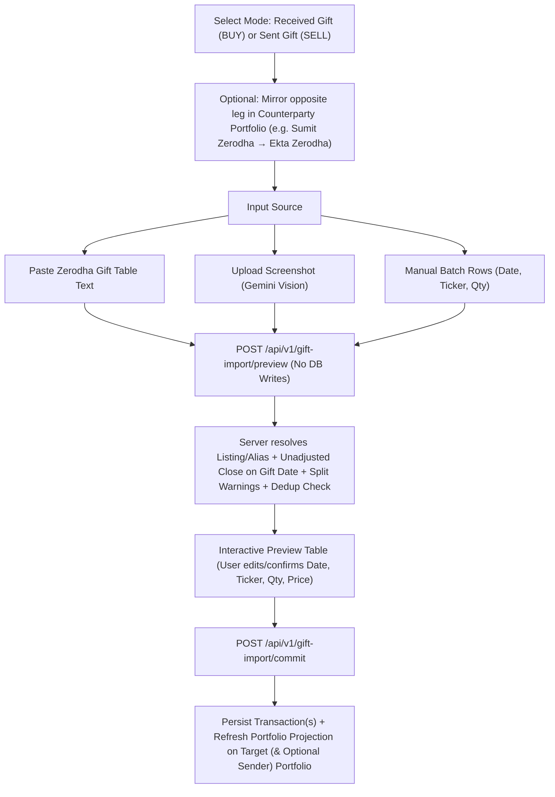

# Feature Spec: Off-Market Gifts, Transfers & Needs-Review Triage Overhaul

**Status:** Draft (Ready for `/plan` and implementation)
**Date:** 2026-11-23
**Related ADRs:** ADR-020 (AI-assisted import boundary), ADR-031 (pure replay-derived holdings), ADR-032 (oversold triage & `-RE` rights), ADR-033 (`MANUAL_USER` source filter), ADR-034 (ISIN aliasing & link-previous)

---

## 1. Context & Production Post-Mortem

Broker tradebook exports and activity feeds (most notably **Zerodha Console Tradebook CSVs** and **SnapTrade Zerodha activity syncs**) record **only exchange-executed trades**. They silently omit every off-market Demat movement:
- CDSL off-market **Gifts** between Zerodha / Demat accounts (e.g., family transfers)
- **IPO allotments** credited directly by the RTA before listing day
- **Subscribed Rights shares** and free `-RE` Rights Entitlements
- **ESOP allotments** and off-market inter-broker Demat transfers

In a real production case (`Sumit Zerodha` gifting 38 NSE positions across 6 batches to `Ekta Zerodha`, with both accounts SnapTrade-linked), five high-friction failure modes surfaced across the **recipient** and **sender** accounts:

1. **Buggy `OVERSOLD` Quantity When a Position Is Re-Bought Later:**
   - In `LedgerGapDetector.classify` (`core/.../LedgerGapDetector.java:42-50`), `missingQty` only inspects `terminal.quantity() < 0`. When a position dips negative mid-stream (e.g., `DREAMFOLKS`: `139` bought − `182` sold = `-43` dip) and is subsequently re-bought (`+200` bought the next day → `+157` terminal shares), `LedgerGapDetector` returns `ReviewState.OVERSOLD` with `missingQty = null`.
   - `HoldingController.getHoldingsByPortfolio` (`api/.../HoldingController.java:267-274`) then triggers a legacy clamped-row fallback (`h.getQuantity().abs()`) and substitutes the user's **positive current holding (`157` instead of `43`; `119` instead of `31` on `ARE&M`)** into `"Sold 157 more shares than your ledger ever bought"`.
2. **Trust-Eroding Copy & `BUY @ ₹0` Performance Distortion:**
   - Telling a user who uploaded every Tradebook CSV *"Sold X more shares than your ledger ever bought"* makes the platform look like it dropped rows.
   - Rendering **`"Mark as bonus allotment"`** (`BUY @ price = 0`, `onReviewMarkRights`) as a primary/secondary button alongside `"Add missing BUY"` tempts users to click it for Demat gifts or NSE bonus shares:
     - For **gifts**, `price = 0` records `0` external cash flow while market value jumps by `qty × close`, manufacturing fake vertical spikes in **Modified Dietz `TWR %`** and **`XIRR`** and treating 100% of subsequent sale proceeds as realized profit.
     - For **Indian bonus shares**, `CorporateActionSplitBackfillJob` already models bonuses in `corporate_action_split` (`source = 'BHAVKOSH_BONUS'`, ratio `(N + D) : D`); adding a `MANUAL_USER` row at `price = 0` causes pre-bonus TWR cliffs against BhavKosh's adjusted bars and double-counts shares once BhavKosh sweeps run.
3. **Locked Quantity & Manual Historical Price Hunting in `add-buy-dialog`:**
   - `AddBuyDialogComponent` (`portfolio/add-buy-dialog/`) hard-locks `quantity` to `prefill.quantity`. When shares were gifted *before* a split or bonus (e.g., `150` `NMDC` gifted on `2024-04-23` → `450` sold after the `2024-12-27` `2:1` bonus; `50` `KOTAKBANK` gifted on `2024-05-27` → `250` sold after the `2026-01-14` `5:1` split), entering the locked post-split quantity (`450` / `250`) on the pre-split gift date causes replay to multiply it *again* (`1,350` / `1,250`), creating phantom active holdings.
   - Users had to manually search external websites for historical NSE closing prices, holiday fallbacks (`2023-12-25` Christmas → `2023-12-22`), and unadjusted pre-split prices—even though `market_data_price_daily` and `corporate_action_split` already exist in PostgreSQL.
4. **Recipient Blind Spot for Unsold Gifts (`heldQty > replayQty`) & Dead-End `"Review Data Issues →"` CTA:**
   - On SnapTrade-linked Zerodha accounts (`Ekta Zerodha`), `SnapTradeHoldingsReconciler` syncs live Demat holdings (including **unsold** gifted shares—`23` of `38` positions), while `transactions` has `0` `BUY` rows for them.
   - This drops `PortfolioLedgerCoverageEvaluator` below `90%` (`INCOMPLETE_LEDGER`) and shows **"Historical curve paused — incomplete transaction ledger"** with a **`Review Data Issues →`** link (`/portfolio/history?tab=missing`)—yet both `/portfolio/history?tab=missing` and `/portfolio`'s **Needs Review** shelf are completely empty once `OVERSOLD` lots are cleared, because `LedgerGapDetector` only inspects `ReplayContext` in isolation (`replayQty < 0`) and never checks `heldQty > replayQty`.
5. **Sender Blind Spot for Gifted-Out Positions (`replayQty > heldQty`) & SnapTrade Rebuild Landmine:**
   - On the SnapTrade-linked sender account (`Sumit Zerodha`), `SnapTradeHoldingsReconciler.persistHoldings` (`api/.../SnapTradeHoldingsReconciler.java:280-290`) deletes the `38` gifted-out positions from `holdings` (`heldQty = 0`), while `transactions` still has the original `BUY`s with **no `SELL`**, leaving `PortfolioReplayService` at `replayQty > 0` (e.g., `+60` `ITC` plus `+6` phantom spun-off `ITCHOTELS`).
   - Because `HoldingService.classifyHoldings` (`api/.../HoldingService.java:131-174`) never passes `holdings` into `LedgerGapDetector`, all `38` positions classify as `ReviewState.OK` and **never appear in Needs Review**—while causing four downstream failures:
     1. **Hard-blocked `XIRR` & Performance Chart with opposite copy:** `PortfolioLedgerCoverageEvaluator` (`core/.../PortfolioLedgerCoverageEvaluator.java:113-122`) hard-vetoes coverage whenever `replayQty > 0 && heldQty == 0 && !mastersWithSellActivity.contains(masterId)`, displaying *"missing backing BUY history"* on `portfolio-performance-chart.component.html` (`lines 103-115`) while both **Needs Review** and **`/portfolio/history?tab=missing`** (`HistoryQueryService.java:258-260`) are completely empty.
     2. **Partial-sell + gift-out terminal cliff bug:** In `PortfolioLedgerCoverageEvaluator` (`lines 119-139`), if a stock had *any* earlier exchange `SELL` (`mastersWithSellActivity == true`) before the remaining shares were gifted out (`replayQty > 0, heldQty == 0`), line `119` does not veto and lines `125-139` do not omit it (they only iterate `heldQty > 0`). `PortfolioPerformanceService` (`lines 542-567`) then values those gifted shares at every historical checkpoint up to yesterday and drops them to `0` at terminal `today`, creating a **fake vertical crash** on the Wealth & TWR chart.
     3. **Distorted Cash-Flow Timeline & phantom corporate actions:** `CashFlowTimelineService` treats the `BUY` capital as permanently deployed with no disposal, and replay continues applying post-gift spin-offs/splits to shares already gifted away.
     4. **SnapTrade `updateHoldingsForPortfolio` landmine:** Unlike `updateHoldingForMaster` (`HoldingService.java:356-363`), `updateHoldingsForPortfolio` (`HoldingService.java:247-335`) does **not** check `snaptradeConnectionRepository.findByPortfolioId(portfolioId)`. Posting a single manual `SELL` to `Sumit Zerodha` today causes `TransactionService` / `CsvImportService` to run `updateHoldingsForPortfolio` and **resurrect all other 37 unclosed gifted positions back into `holdings`** (or overwrite live SnapTrade quantities where `replayQty != heldQty`) until the next SnapTrade sync wipes them again (or permanently if converted to Manual).
   - Meanwhile, Zerodha Console's Gift History screen (`Console → Portfolio → Gifts`) has **no CSV export**—only an HTML table (`Recipient | ID | YYYY-MM-DD | TICKER1 (QTY1), TICKER2 (QTY2), ...`).

---

## 2. Non-Negotiable Domain & Compliance Invariants

1. **Pure Transaction Ledger & SnapTrade Position Authority (ADR-031):**
   - Never write directly to `holdings` from manual/CSV/gift repair flows. Every gift/IPO/transfer repair creates immutable `Transaction` rows (`BUY` for received gifts/IPOs, `SELL` for sent gifts).
   - **Manual / CSV portfolios (`snaptradeConnection` absent):** `HoldingService.updateHoldingsForPortfolio(portfolioId)` rebuilds `holdings` from replay. (Note: on a purely manual portfolio with no live broker snapshot, the system cannot infer an unrecorded gift-out on its own; Phase 2's dual-portfolio mirroring solves that at import time.)
   - **Active SnapTrade-linked portfolios (`snaptradeConnection` present):** `SnapTradeHoldingsReconciler` is authoritative for live `holdings` rows and quantities. `updateHoldingsForPortfolio` must **not** overwrite or resurrect `Holding` rows from `terminalByMaster()` when a SnapTrade connection exists (matching `updateHoldingForMaster` at `HoldingService.java:356-363`); replay dynamically supplies AVCO cost basis, realized P&L, and `ReviewState` on read, and `UserHoldingsChangedEvent` still fires.
2. **Date ↔ Price Consistency (TWR, PME & XIRR Integrity):**
   - When recording a gift (`BUY` or `SELL`) on `giftDate`, the default price **must** be the **unadjusted fair market close on `giftDate`** (stepping back to the most recent prior trading session on weekends/holidays).
   - Pairing `giftDate` with an old sender purchase price (or `0`) mismatches `EXTERNAL_TRADE` cash flow (`qty × price`) against checkpoint market valuation (`qty × close`), creating artificial sub-period jumps in `TWR %` and `XIRR`.
3. **Provider-Aware Unadjusted Historical Close Formula (`CRITICAL`):**
   - `market_data_price_daily` stores daily closes with **different split-adjustment conventions by `source`** (see `PortfolioPerformanceService.adjustBarCloseToTerminalBasis`, lines `1039-1059`):
     - **`source = 'BHAVKOSH'` (NSE/BSE):** Stored **already adjusted to terminal split/bonus basis**. To recover the **unadjusted actual trading close** on `barDate` for a `Transaction.price`, **multiply** `rawClose × cumulativeSplitFactorAfter(barDate)` (product of `s.factor()` for all `CorporateActionSplit` rows on that canonical master with `s.exDate > barDate`).
     - **`source = 'YAHOO'` / `'EODHD'` (Global):** Stored as **raw unadjusted closes** on `barDate`. Use `rawClose` directly (do **not** multiply by `postSplitFactor`).
   - Always use `BigDecimal` (`DECIMAL128` intermediate, rounded to scale `2` or `4` as appropriate); never `double`.
4. **Market Data Licensing Compliance:**
   - Do **not** expose any raw historical candle series endpoint.
   - Only return a **single scalar reference close** (`asOfTradingDate`, `unadjustedClose`, `currency`, `postDateSplitFactor`) for a specific `(securityListingId, requestedDate)` owned/accessible by the authenticated user (with per-user rate limiting), or populate scalar prices server-side inside the Gift Preview response.
5. **LLM Boundary Discipline (ADR-020):**
   - In screenshot mode, Vision LLM (`Gemini`) may extract **only** structured `(date, rawTicker, quantity)` candidates—**never prices**, and **never** direct DB writes.
   - All ticker/listing resolution, historical price lookup, split checks, deduplication, and `BigDecimal` math run deterministically in Java and require explicit user confirmation in a **Preview Table**.

---

## 3. Phased Architecture & Scope

### Phase 1: High-Trust Needs-Review Triage & Smart Missing-Transaction Dialog (`BUY` & `SELL`)

#### 1.1 Fix `OVERSOLD` Shortfall, SnapTrade Position-vs-Ledger Reconciliation, Coverage Cliff & Rebuild Guard (`core` + `api`)
- **Mid-stream `OVERSOLD` shortfall (`RealizedGainCalculator` / `PortfolioReplayService` / `LedgerGapDetector`):**
  - Track the **peak cumulative shortfall** (or minimum running quantity excursion below zero, accounting for splits) across each master's chronological walk—not just `terminal.quantity() < 0`.
  - Example (`DREAMFOLKS`): running qty dips to `-43` on `2026-03-23`, then `+200` on `2026-03-24` (`terminal.quantity = +157`). `LedgerGapDetector` must emit `missingQty = 43` (pre-dated to `2026-03-22`, or before the offending `SELL`), **never `null`**.
  - Note on post-dip splits: if a split of factor $F$ occurred *between* the offending `SELL` and terminal date, verify whether the shortfall happened pre-split or post-split so `suggestedQuantity` matches the units on `suggestedTransactionDate`.
- **`HoldingController` (`api/.../HoldingController.java:267-274`):**
  - Guard or remove the legacy `h.getQuantity().abs()` fallback so a positive `h.getQuantity()` (`> 0`) can **never** be copied into `ReviewActionHint.suggestedQuantity` for an `OVERSOLD` row.
- **`HoldingService.updateHoldingsForPortfolio` SnapTrade Guard (`api/.../HoldingService.java:247-335`):**
  - Mirror `updateHoldingForMaster` (`lines 356-363`): when `snaptradeConnectionRepository.findByPortfolioId(portfolioId).isPresent()`, skip writing/deleting `Holding` rows from `terminalByMaster()` (still running `deleteAliasHoldingsForPortfolio` if appropriate and publishing `UserHoldingsChangedEvent`). This prevents manual ledger fixes on a SnapTrade portfolio from resurrecting gifted-out positions into `holdings`.
- **`TransactionService.deleteTransaction` (`api/.../TransactionService.java:171-177`):**
  - Fix orphan `Holding` bug on non-SnapTrade portfolios when deleting the **last** transaction for a security: `updateHoldingsForPortfolio` only iterates `result.terminalByMaster().entrySet()`, so a master whose transaction count drops to `0` disappears from `terminalByMaster()` without deleting its `Holding` row. Explicitly call `holdingService.updateHoldingForMaster(portfolioId, deletedMasterId)` (or delete unreferenced non-SnapTrade holdings) on `deleteTransaction`.
- **Bidirectional SnapTrade Position-vs-Ledger Reconciliation (`HoldingService.classifyHoldings` + `ReviewState`):**
  - For SnapTrade-linked portfolios whose `SnaptradeConnection` is settled (`sync_phase == COMPLETE`, not mid-sync or pending activity catch-up), pass the portfolio's active `holdings` (`heldQty` per effective `security_master_id`) into `classifyHoldings`:
    1. **`heldQty - replayQty > QTY_COVERAGE_TOLERANCE` → `ReviewState.MISSING_BUY_HISTORY`:**
       - Active holding in Demat has more shares than replay (`suggestedQuantity = heldQty - replayQty`, `suggestedEventKind = "BUY"`). Surfaces the `23` unsold received gifts in `Ekta Zerodha` directly on their `HoldingDto` rows.
    2. **`replayQty - heldQty > QTY_COVERAGE_TOLERANCE` → `ReviewState.UNRECORDED_DISPOSAL`:**
       - Ledger replay thinks the user still holds shares that are gone from live Demat (`suggestedQuantity = replayQty - heldQty`, `suggestedEventKind = "SELL"`).
       - Covers **both** partial gift-outs (`0 < heldQty < replayQty`, attached to the active `HoldingDto`) **and** full gift-outs / unseeded renames (`heldQty == 0`, emitted by `HoldingController` as `synthetic = true` ghost rows on the **Needs Review** shelf).
       - **Spin-off child suppression rule:** If a master with `replayQty > 0 && heldQty == 0` has **no direct `Transaction` rows** (`masterTxns.isEmpty()`) and acquired its shares solely via an ephemeral `SPINOFF_IN` whose parent master is *itself* flagged `UNRECORDED_DISPOSAL` (e.g., phantom `6` `ITCHOTELS` from unclosed `60` `ITC` in `Sumit Zerodha`), suppress the child ghost row so closing the parent on the pre-spinoff gift date automatically clears both without prompting a bogus child `SELL`.
- **`PortfolioLedgerCoverageEvaluator` Cliff Fix & Paused-Chart UX (`core/.../PortfolioLedgerCoverageEvaluator.java:113-143` + `portfolio-performance-chart`):**
  - Close the partial-sell + gift-out loophole: when `replayQty > 0 && heldQty == 0` **and** `mastersWithSellActivity.contains(masterId)` is `true`, do **not** let the master pass un-omitted into `replayCheckpoints` (which creates a vertical cliff crash to `0` on `today`). Disqualify or add to `newlyUncoveredSeeds` (`expandOmittedAcrossChains`) consistently with `replayQty > heldQty`.
  - Update the paused-chart banner copy in `portfolio-performance-chart.component.html` (`lines 103-115`) to cover both missing acquisitions and unrecorded disposals/transfers, and route **`Review Data Issues →`** to `/portfolio` (scrolling/expanding **Needs Review**) or unify `/portfolio/history?tab=missing` with `classifyHoldings` so the CTA **never** lands on an empty screen.

#### 1.2 Trust-Preserving Copy & CTA Hierarchy (`needs-review-shelf` Component)
- **`OVERSOLD` & `MISSING_BUY_HISTORY` rows:**
  - Copy:
    > **Missing acquisition for {{ qty }} shares** — Broker tradebooks only include exchange trades and omit Demat gifts, IPO allotments, off-market transfers, or unimported earlier-year CSVs.
  - CTA hierarchy:
    - **For `-RE` tickers** (`ticker.endsWith('-RE')`, per ADR-032): Primary **`Mark as rights allotment (₹0)`**, Secondary **`Add missing BUY`**, Overflow **`Dismiss`**.
    - **For all normal tickers:** Primary **`Add missing BUY / Gift`**, Overflow (`…`) **`Link to previous ticker`**, **`Mark as free entitlement (₹0)`** *(with explicit warning that ₹0 cost treats 100% of proceeds as gain and must NOT be used for stock splits, NSE bonus issues, or Demat gifts)*, and **`Dismiss`**.
- **`UNRECORDED_DISPOSAL` rows (`replayQty > heldQty` on SnapTrade portfolios):**
  - Copy:
    > **Unrecorded exit for {{ qty }} shares** — Your ledger still holds {{ qty }} shares not present in your live broker account (e.g., gifted out via CDSL, off-market transfer, buyback, or ticker rename).
  - CTA hierarchy:
    - Primary: **`Record gift-out / SELL`** (opens the inline fix dialog in `SELL` mode).
    - Secondary / Overflow (`…`): **`Link to another ticker`** *(escape hatch when an unseeded rename/demerger moved shares to a new symbol in the same account)* and **`Dismiss`**.

#### 1.3 Scalar Historical Close Lookup & Smart Inline Fix Dialog (`BUY` & `SELL` Modes)
- **Backend endpoint:** `GET /api/holdings/listings/{listingId}/historical-close?date=YYYY-MM-DD`
  - Authenticated + rate-limited.
  - Finds the canonical `MarketDataSymbol` for `listingId` (or sibling primary listing on the same effective `SecurityMaster`), queries the latest `market_data_price_daily` bar on or before `date` within a 10-calendar-day lookback window (handling weekends and exchange holidays like Christmas `2023-12-25` → `2023-12-22`).
  - Applies the **Provider-Aware Unadjusted Price Formula** (§2.3) so `unadjustedClose` matches actual market trading prices on `asOfTradingDate`.
  - Also computes `cumulativePostDateSplitFactor` (from `corporate_action_split` where `exDate > date`).
  - Response DTO:
    ```json
    {
      "requestedDate": "2024-04-23",
      "asOfTradingDate": "2024-04-23",
      "unadjustedClose": 234.65,
      "currency": "INR",
      "postDateSplitFactor": 3,
      "preSplitEquivalentQuantity": 150
    }
    ```
    *(Returns `204 No Content` or `available: false` cleanly when no historical bar exists in DB yet, allowing manual entry without error).*
- **Frontend `AddBuyDialogComponent` (generalized to support `transactionType: 'BUY' | 'SELL'`):**
  1. **Mode-aware title & submit:** Renders *"Add missing BUY / Gift"* (`BUY`) for `OVERSOLD` / `MISSING_BUY_HISTORY` and *"Record gift-out / SELL"* (`SELL`) for `UNRECORDED_DISPOSAL`.
  2. **Editable `Quantity` input** (seeded with `prefill.quantity`, validated `> 0`).
  3. **Auto-fill `Price` when `Date` changes:** Calls `historical-close`, populates `price` with `unadjustedClose`, and shows a subtle helper caption: *"NSE close on 22 Dec 2023 (last trading day before 25 Dec) — editable for IPO/custom price."* (Does not overwrite a price the user manually edited unless they click `"Use market close"` or pick a new date while clean).
  4. **Pre-Split / Pre-Bonus Banner:** When `postDateSplitFactor > 1` (e.g., user picks `2024-04-23` on `NMDC` where `prefill.quantity = 450` and `postDateSplitFactor = 3`), surface an inline one-click banner in both `BUY` and `SELL` modes:
     > *`NMDC` had a `3:1` split/bonus after `2024-04-23`. Adjust quantity from `450` → **`150`** pre-bonus shares?* **[Apply 150]**

#### 1.4 Proactive Post-CSV-Import Callout (`bulk-changes-tab`)
- On the CSV commit summary screen (especially when Indian `NSE`/`BSE` trades or `OVERSOLD` rows are present), display a concise callout:
  > *Have IPO allotments or Demat gifts (e.g. Zerodha Gifts)? Broker tradebooks only export exchange trades.* **[Import Gifts / Off-Market Transfers]**

---

### Phase 2: Bulk Gift & Off-Market Transfer Importer (Paste + Screenshot → Preview → Commit)

#### 2.1 User Flow & Dual-Portfolio Reconciliation
Add a **`Gifts & Transfers`** mode inside **Add Assets** (`app-add-transaction-modal`) designed around Zerodha Console's Gift table and general off-market transfers:



- **Dual-Portfolio Mirroring (Killer Feature for Family/Multi-Account Users):**
  - Primary selector: **Recipient Portfolio** (`BUY` leg, e.g. `Ekta Zerodha`) or **Sender Portfolio** (`SELL` leg, e.g. `Sumit Zerodha`).
  - Optional checkbox when the user has `>= 2` same-currency portfolios: **"Also record matching gift-out (`SELL`) in sender portfolio: `[Dropdown: Sumit Zerodha]`"** (using the **exact same `transactionDate`, `securityListingId`, `quantity`, and `price`** so combined net worth across both accounts has zero discontinuity and zero double-counting).

#### 2.2 Three Input Parsers Converging on One Preview Pipeline
1. **Deterministic Zerodha Gift Text Parser (Zero LLM cost):**
   - Recognizes pasted lines/blocks from Zerodha Console (`Console → Portfolio → Gifts`), e.g.:
     `2024-04-23  COALINDIA (50), TATAELXSI (3), NMDC (150), HINDZINC (88)`
   - Regex extracts `LocalDate` (`yyyy-MM-dd` or `dd MMM yyyy`) and all `([A-Z0-9&-]+)\s*\((\d+(?:\.\d+)?)\)` pairs on the line/block.
2. **Screenshot Vision Parser (Opt-In Convenience via Existing Gemini Config):**
   - Accepts PNG/JPEG/WebP (`<= 5 MB`, validated magic bytes, rate-limited per user).
   - Sends image to Gemini with a strict JSON schema prompt extracting **only** `[{ "date": "YYYY-MM-DD", "ticker": "STRING", "quantity": "STRING" }]`.
   - Zero price extraction by LLM; zero DB writes.
3. **Manual Batch Grid:**
   - Add/edit rows of `(Date, Exchange [default NSE for INR portfolios], Ticker, Quantity)` directly.

#### 2.3 Preview Enrichment & Alias-Aware Ticker Resolution
For each extracted `(date, rawTicker, exchange, quantity)`:
1. **Listing & Rename Resolution:**
   - Resolve `(exchange, rawTicker)`. If the user's target portfolio has an orphan `SELL` on a renamed successor master (e.g. gift row says `ICICITECH (1545)` while `security_listing_rename_history` or ISIN alias links `ICICITECH → ITIETF`, or user holds `ITIETF`), resolve through `SecurityMaster.getEffectiveId()` so the `BUY` / `SELL` lands on the canonical master.
   - Surface unresolved tickers clearly in the preview row for inline user selection.
2. **Automatic Historical Close Lookup:**
   - Batch-load `market_data_price_daily` + `corporate_action_split` across all previewed listings (no N+1 queries) and populate `unadjustedClose` + `asOfTradingDate` per §2.3.
   - If a symbol is cold (never backfilled yet in `market_data_price_daily`), show `"Price pending — enter price or trigger lookup"` (never block HTTP threads on external Yahoo/BhavKosh calls, preserving the no-sync-HTTP hot-path invariant).
3. **Deterministic Deduplication:**
   - Compute deterministic `externalId = "gift:v1:" + sha256_16(portfolioId|effectiveMasterId|isoDate|type|qty)` AND flag a soft warning in Preview if a `MANUAL_USER` transaction with the same `(effectiveMasterId, date, type, qty)` already exists in that portfolio (so users who already manually fixed 15 `OVERSOLD` rows can safely import a 38-stock gift screenshot and auto-skip the 15 already-entered rows while still committing all 38 `SELL` legs to the sender portfolio!).

---

## 4. Key Files to Inspect When Starting Implementation

### Backend (`portfolio-optimizer-backend`)
- `core/src/main/java/com/portfolio/tracker/core/dto/ReviewState.java` (add `MISSING_BUY_HISTORY`, `UNRECORDED_DISPOSAL`)
- `core/src/main/java/com/portfolio/tracker/core/service/RealizedGainCalculator.java` (`detectAnomalies`, `AvcoState`)
- `core/src/main/java/com/portfolio/tracker/core/service/LedgerGapDetector.java` (`classify` — mid-stream `OVERSOLD` `missingQty` bug at lines `42-50`)
- `core/src/main/java/com/portfolio/tracker/core/service/PortfolioLedgerCoverageEvaluator.java` (hard veto at lines `113-122` & partial-sell + gift-out cliff loophole at lines `119-139`)
- `core/src/main/java/com/portfolio/tracker/core/service/HistoryQueryService.java` (`missing` tab parity at lines `258-260`)
- `api/src/main/java/com/portfolio/tracker/api/service/HoldingService.java` (`classifyHoldings` at lines `131-174`; missing SnapTrade guard in `updateHoldingsForPortfolio` at lines `247-335` vs `updateHoldingForMaster` at lines `356-363`)
- `api/src/main/java/com/portfolio/tracker/api/controller/HoldingController.java` (legacy `h.getQuantity().abs()` fallback at lines `267-274`; synthetic ghost loop at lines `283-315`)
- `api/src/main/java/com/portfolio/tracker/api/service/snaptrade/SnapTradeHoldingsReconciler.java` (`persistHoldings` live snapshot delete loop at lines `280-290`)
- `api/src/main/java/com/portfolio/tracker/api/service/analytics/PortfolioPerformanceService.java` (`adjustBarCloseToTerminalBasis` at lines `1039-1059` — reference for `BHAVKOSH` vs `YAHOO` split-adjustment semantics)
- `api/src/main/java/com/portfolio/tracker/api/service/TransactionService.java` (`createTransaction`, `deleteTransaction`)
- `api/src/main/java/com/portfolio/tracker/api/service/csvimport/CsvImportService.java` (preview/commit + dedup hash pattern)

### Frontend (`portfolio-optimizer-frontend`)
- `src/app/portfolio/needs-review-shelf/` (render `MISSING_BUY_HISTORY` & `UNRECORDED_DISPOSAL`, copy, CTA ordering, overflow menu)
- `src/app/portfolio/add-buy-dialog/` (support `BUY` & `SELL` modes, unlock `quantity`, wire date-change `historical-close` auto-fill, pre-split quantity helper)
- `src/app/shared/charts/portfolio-performance-chart/portfolio-performance-chart.component.html` (paused-ledger guard copy & `Review Data Issues →` routing at lines `103-115`)
- `src/app/portfolio/add-transaction-modal/` & `bulk-changes-tab/` (post-CSV callout + Phase 2 `Gifts & Transfers` tab)
- `src/app/portfolio/portfolio.component.ts` (`onReviewFix`, `onReviewMarkRights`)

---

## 5. Open Follow-Up for Production Data (`Sumit Zerodha` → `Ekta Zerodha`)

Once Phase 1 / Phase 2 ships:
- Import the remaining **23 unsold gifted positions** into `Ekta Zerodha` (`RELIANCE (70)`, `HDFCBANK (207)`, `ICICIBANK (54)`, `HAL (32)`, `POWERGRID (400)`, `TCS (17)`, `COALINDIA (50)`, `TATAELXSI (3)`, `TATATECH (15)`, `PFC (65)`, `DMART (12)`, `KPITTECH (19)`, `RECLTD (99)`, `WABAG (30)`, `DELTACORP (280)`, `CDSL (8)`, `ICICIGI (30)`, `TATAPOWER (46)`, `HINDUNILVR (69)`, `ASIANPAINT (52)`, `ASTRAL (24)`, `SETFNIF50 (356)`, `INDIGOPNTS (76)`).
- Record the matching **38 gift-out `SELL` transactions** in `Sumit Zerodha` on their respective gift dates (`2023-12-21` through `2024-05-27`) so `Sumit Zerodha` clears all `UNRECORDED_DISPOSAL` gaps, unlocks `XIRR` and the Performance & Benchmark Alpha chart, and automatically eliminates phantom post-gift spin-offs (such as the `6` `ITCHOTELS` from `60` `ITC`).
